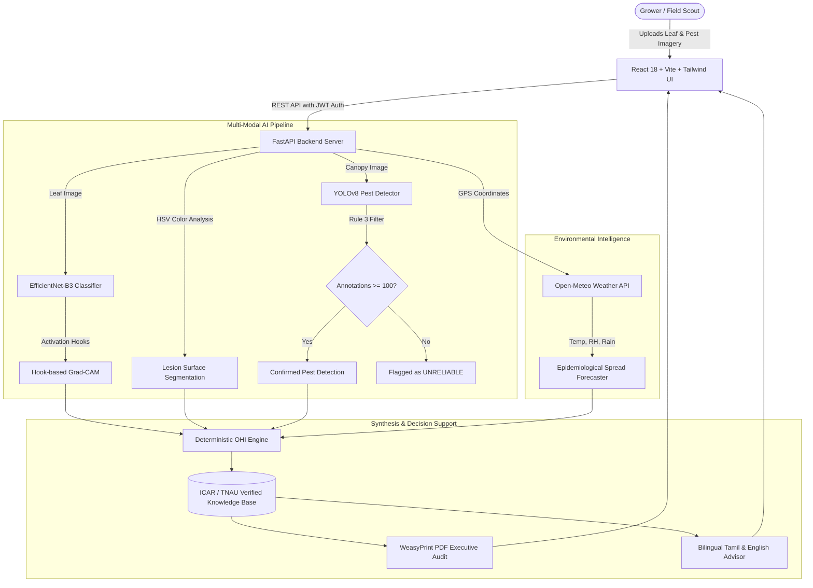

# 🥭 AI Mango Orchard Health & Pest Intelligence
## Master Presentation Deck & Pitch Guide

**Document Purpose:** Presentation script, slide deck structure, speaker notes, and demonstration flow for project defense, stakeholder pitches, investor reviews, or university capstone presentations.  
**File:** `PROJECT_PRESENTATION_SUMMARY.md`  

> ⚠️ **UNVERIFIED DRAFT (audit 2026-10-17).** No model in this repository has been trained yet, so the system currently reports disease and pest results as *unavailable*. Invented figures that previously appeared here (demo confidences, OHI demo score, yield/pesticide impact percentages, accuracy claims, market statistics) have been removed. Re-add numbers only from `results/` files (see `PROGRESS.md`).

---

## 1. Executive Presentation Overview

- **Project Title:** AI Mango Orchard Health & Pest Intelligence
- **Subtitle:** Precision Crop Pathology, Microclimate Epidemiological Forecasting, and Source-Verified Decision Support for Mango Growers
- **Duration:** 15–20 minutes (with 5-minute Q&A)
- **Target Audience:** Agronomists, AI Researchers, Agricultural Technology Evaluators, Farm Co-ops, and Investors
- **Key Takeaway Message:** "We have built a transparent, deterministic, and source-verified AI decision support system that detects diseases and pests, explains its reasoning visually via Grad-CAM, computes an auditable Orchard Health Index (OHI), forecasts weather-driven outbreaks, and communicates with farmers in their native language (English & Tamil)."

---

## 2. Slide-by-Slide Deck Structure & Speaker Script

```
┌────────────────────────────────────────────────────────────────────────┐
│                        SLIDE DECK NAVIGATION                           │
├───────────────────┬───────────────────┬────────────────────────────────┤
│ Slide 1: Title    │ Slide 6: Grad-CAM │ Slide 11: Bilingual Chatbot    │
│ Slide 2: Problem  │ Slide 7: YOLOv8   │ Slide 12: React & PDF Reports  │
│ Slide 3: Solution │ Slide 8: OHI Math │ Slide 13: Live Demo Script     │
│ Slide 4: Diagram  │ Slide 9: Weather  │ Slide 14: Agronomic Impact/ROI │
│ Slide 5: Diseases │ Slide 10: Citations│ Slide 15: Q&A / Future Vision  │
└───────────────────┴───────────────────┴────────────────────────────────┘
```

---

### Slide 1: Title Slide & Introduction
- **Visuals:** High-resolution mango orchard banner, logos of Python, PyTorch, YOLOv8, FastAPI, React, and Supabase.
- **Header:** AI Mango Orchard Health & Pest Intelligence
- **Subheader:** A Deterministic Multi-Modal Decision Support System for Sustainable Mango Cultivation
- **Presenter:** [Your Name / Research Team]
- **Speaker Talking Points:**
  > "Good morning/afternoon, everyone. Today, I am proud to present our project: *AI Mango Orchard Health & Pest Intelligence*. Mango is known as the 'King of Fruits', and India is its largest producer [cite a verified FAO/NHB figure]. Yet orchardists lose a significant share of their yields to foliar diseases and insect pests [citation needed], while often overusing chemicals. Today, I will demonstrate how our system solves this using state-of-the-art vision models, deterministic mathematical scoring, microclimate forecasting, and verified agronomic protocols."

---

### Slide 2: The Core Problem in Mango Cultivation
- **Visuals:** Split screen showing Anthracnose-damaged leaves, Fruit Fly fruit damage, and blanket chemical sprayers.
- **Bullet Points:**
  - **Yield Loss:** Significant losses from Anthracnose, Powdery Mildew, Bacterial Canker, and Fruit Flies [citation needed — no figure until sourced].
  - **Diagnostic Delay:** Laboratory pathology or expert field scouting takes days to weeks—by then, sporulation has spread.
  - **The 'Black Box' AI Crisis:** Most agricultural AI systems provide opaque percentages without explaining why or how severe the infection is.
  - **Pesticide Abuse:** Growers spray broad-spectrum chemicals blindly, risking pesticide resistance, export rejections due to Maximum Residue Limit (MRL) violations, and environmental harm.
  - **Language Barrier:** Smallholder farmers in key mango regions (e.g., Tamil Nadu, Andhra Pradesh) struggle to interpret complex English agricultural manuals.
- **Speaker Talking Points:**
  > "Growers face a triple challenge: late diagnosis, excessive chemical expenditure, and opaque advice. When modern AI is introduced, farmers often reject it because it acts as an uninterpretable black box. Our mission was to build an intelligent platform that is accurate, visually explainable, scientifically auditable, and accessible in the grower's regional language."

---

### Slide 3: The Solution — Unified Precision Agriculture Platform
- **Visuals:** 4 pillars: (1) Vision AI + Grad-CAM, (2) Deterministic OHI Engine, (3) Microclimate Forecast, (4) Source-Verified Treatment in English & Tamil.
- **Key Value Propositions:**
  - **Dual-Input Diagnostics:** Evaluates leaf pathology and canopy insect traps simultaneously.
  - **Visual Explainability (XAI):** Non-invasive hook-based Grad-CAM pinpoints exact infection loci.
  - **Transparent Mathematical Engine (OHI):** A single composite health score (0–100) with full mathematical accountability.
  - **Microclimate Risk Prediction:** Real-time 7-day weather ingestion predicting pathogen sporulation windows.
  - **Source-Verified Protocols:** Every dosage and active ingredient links to ICAR (Indian Council of Agricultural Research) and TNAU (Tamil Nadu Agricultural University).
- **Speaker Talking Points:**
  > "Rather than just building another image classifier, we engineered an integrated precision agriculture platform. It takes leaf and canopy imagery, combines it with live weather data, computes an auditable health index, and issues verified agronomic actions."

---

### Slide 4: System Architecture & Dataflow
- **Visuals:** End-to-end architectural diagram:



- **Speaker Talking Points:**
  > "Here is our architectural pipeline. When an image is uploaded through our React frontend, our FastAPI backend coordinates three simultaneous intelligence streams: the deep learning vision pipeline, the HSV lesion area segmenter, and the Open-Meteo microclimate forecaster. These feed into our deterministic OHI engine, which queries our verified ICAR/TNAU database to produce actionable guidance and an executive PDF audit report."

---

### Slide 5: Foliar Disease Diagnostics (EfficientNet-B3)
- **Visuals:** Sample leaf images of the 5 classes with classification confidence cards.
- **Classes Covered:**
  1. *Anthracnose* (*Colletotrichum gloeosporioides*)
  2. *Bacterial Canker* (*Xanthomonas citri* pv. *mangiferaeindicae*)
  3. *Powdery Mildew* (*Oidium mangiferae*)
  4. *Sooty Mold* (*Capnodium mangiferae*)
  5. *Healthy Foliage*
  (Leaf Spot was dropped: no openly licensed training images exist.)
- **Technical Highlights:**
  - Architecture: **EfficientNet-B3** via PyTorch & `timm` (12.2M parameters; optimal trade-off between edge throughput and representation capacity).
  - Input: $300 \times 300$ resolution with ImageNet normalization.
  - Lesion Surface Area Computation: HSV color-space thresholding measures the exact percentage of infected foliar tissue ($A_{\text{lesion}}$).
- **Speaker Talking Points:**
  > "For foliar disease detection, we selected EfficientNet-B3. It provides state-of-the-art accuracy with a lightweight 12-million parameter footprint. Beyond simply naming the disease, our computer vision module segments the necrotic lesions in HSV color space to calculate the exact percentage of damaged leaf area."

---

### Slide 6: Visual Explainability (Hook-Based Grad-CAM)
- **Visuals:** Side-by-side comparison: Raw leaf $\rightarrow$ Jet colormap heatmap $\rightarrow$ Semi-transparent overlay highlighting necrotic lesions.
- **Core Innovations:**
  - **Zero Model Surgery:** Uses PyTorch forward and backward tensor hooks registered directly on `model.conv_head`.
  - **No Retraining or Architecture Modifications:** Operates dynamically during the inference forward-backward pass.
  - **Trust & Verification:** Lets a user check whether the network is attending to lesions rather than background (Grad-CAM is a qualitative aid; quantitative evaluation is planned).
- **Speaker Talking Points:**
  > "To eliminate the black-box problem, we implemented hook-based Grad-CAM. By attaching non-invasive PyTorch forward and backward hooks to the final convolutional layer, we generate a high-resolution attention heatmap. Growers and extension officers can immediately see that the AI is making its diagnosis based on the authentic necrotic spots rather than image background noise."

---

### Slide 7: Canopy Pest Detection & Inviolable Rule 3
- **Visuals:** YOLOv8 bounding boxes around Fruit Flies and Mealybugs; cautionary amber banner for Mango Hopper.
- **Key Architectures & Safeguards:**
  - Architecture: **Ultralytics YOLOv8** for real-time bounding box localization.
  - **Confirmed Pest Classes:** Fruit Fly (*Bactrocera dorsalis*), Mealy Bug (*Drosicha mangiferae*), Scale Insect (*Coccus viridis*).
  - **Inviolable Architectural Rule 3 (Gated Classes):**
    > *Mango Hopper and Stem Borer must NOT be presented as reliable vision detections until $\ge 100$ verified field bounding boxes are annotated.*
  - **Automated Gating:** If a hopper or borer is inferred, the system sets `is_unreliable=True` and alerts the grower: *"Sample size < 100; physical trap verification required."*
- **Speaker Talking Points:**
  > "For pests, we use YOLOv8. But here is where our engineering ethics differ from typical hackathons: we instituted Inviolable Rule 3. Because Mango Hoppers and Stem Borers had fewer than 100 verified bounding-box annotations in public repositories, we refuse to present them as confident detections. The system automatically tags them as 'Unreliable' and instructs the scout to perform physical inspection. We never hallucinate certainty at the expense of a farmer's crop."

---

### Slide 8: Deterministic Orchard Health Index (OHI)
- **Visuals:** Formula breakdown graphic and the 4 tier color badges.
- **The Mathematical Formula:**
  $$\text{OHI} = 100 - \left(w_d \cdot S_d + w_p \cdot P_p + w_w \cdot W_v + w_n \cdot N_d\right)$$
- **Transparent Components:**
  1. **Disease Severity ($S_d$):** Combines pathogen virulence multiplier ($\alpha_c$) and segmented lesion area ($A_{\text{lesion}}$).
  2. **Pest Pressure ($P_p$):** Weighted sum of bounding box densities and pest impact factors ($\beta_k$).
  3. **Weather Vulnerability ($W_v$):** Microclimate risk from high humidity, warm temperatures, and rainfall.
  4. **Nutrient Deficiency Placeholder ($N_d$):** **Inviolable Rule 4**—Soil nitrogen is explicitly disclosed as defaulted to 0, and its $0.10$ weight is reallocated dynamically to disease and pest factors.
- **Four Health Tiers:**
  - $85 - 100$: Optimal Health (Emerald)
  - $70 - 84$: Mild Stress / Warning (Amber)
  - $50 - 69$: High Infestation Risk (Orange)
  - $0 - 49$: Critical Outbreak (Red)
- **Speaker Talking Points:**
  > "Instead of letting a neural network output a random 'healthiness' score, our Orchard Health Index is 100% deterministic and mathematical. Every single point deducted from 100 can be traced to a specific leaf lesion, a counted pest, or favorable fungal weather. If sensors are missing—like soil nitrogen—the system explicitly discloses this in the UI and normalizes the weights."

---

### Slide 9: Microclimate Disease Spread Forecasting
- **Visuals:** 7-day temperature and humidity curve from Open-Meteo with pathogen sporulation risk bars.
- **Mechanism:**
  - Automated latitude/longitude lookup via Open-Meteo (no API keys required, zero downtime).
  - **Pathogen Propagation Rules:**
    - Fungal Sporulation Trigger: $\text{Relative Humidity} \ge 80\%$ and $22^\circ\text{C} \le \text{Temp} \le 32^\circ\text{C}$.
    - Rain Washout / Spore Splash: Precipitation $\ge 2.0\text{ mm}$.
  - Computes a 7-day forward-looking outbreak probability curve, allowing growers to apply prophylactic organic fungicides *before* spores germinate.
- **Speaker Talking Points:**
  > "Treating a fungal outbreak after it has consumed 20% of the canopy is too late. Our system connects to Open-Meteo to track microclimate humidity and temperature windows. If relative humidity exceeds 80% with temperatures between 22 and 32 degrees Celsius, our forecaster flags upcoming days with favourable conditions in the 7-day forecast. (These rules have not yet been validated against outbreak records.)"

---

### Slide 10: Verified Agronomic Protocols & Source Citations
- **Visuals:** Excerpt of ICAR and TNAU research bulletins; sample treatment recommendation card.
- **Inviolable Architectural Rule 2:**
  > *Every chemical dosage, active ingredient, biological agent, and cultural practice must have an explicit citation to ICAR, TNAU, or DPPQS.*
- **Sample Verified Protocols** (checked against the live sources on 2026-10-17; see `docs/sources.md`):
  - **Anthracnose:** *Pseudomonas fluorescens* (FP 7) 5 g/L on flowers every 3 weeks from October (*TNAU Agritech, Anthracnose*); copper oxychloride 0.3% for leaf infection (*NHM IPM Schedule for Mango, 2012*).
  - **Powdery Mildew:** Wettable sulphur 0.2% when panicles are 3–4 inches, second spray 15 days later (*TNAU Agritech; NHM 2012*).
  - **Fruit Fly:** Destroy fallen fruit, summer ploughing (*TNAU*); methyl eugenol traps 10/ha during fruiting (*NHM 2012*). Malathion is banned on mango (CIB&RC, 2023) and is no longer suggested.
  - **Bacterial Canker:** Sanitation, windbreaks, copper oxychloride 0.3% in severe infection (*NHM 2012*).
- **Verification finding:** the earlier sample protocols included chemicals that are banned or restricted for mango (malathion, dimethoate, dichlorvos, dinocap). They were removed; every remaining entry has a deep link and a quote.
- **Speaker Talking Points:**
  > "In agriculture, incorrect dosage kills crops and violates export standards. Under Inviolable Rule 2, no recommendation exists in our database without a verified citation to the Indian Council of Agricultural Research, Tamil Nadu Agricultural University, or DPPQS. Every entry links to the exact page and was checked against India's banned-pesticide list; the app asks the farmer to confirm the product label allows use on mango."

---

### Slide 11: Bilingual Advisory Chatbot (English & Tamil)
- **Visuals:** Side-by-side screenshot of conversational UI in English and Tamil (தமிழ்).
- **Features:**
  - Instant vernacular query resolution for smallholder farmers.
  - Supports Tamil queries about Anthracnose only (other topics not yet covered): e.g., *"மா மரத்தில் ஆந்த்ராக்னோஸ் இலை நோய் தீர்வு என்ன?"* $\rightarrow$ returns the Copper Oxychloride dosage with a TNAU citation.
  - Guardrailed against generic LLM hallucinations: queries our curated agronomic database first.
- **Speaker Talking Points:**
  > "Many mango growers in South India work primarily in Tamil. We built a keyword-based chatbot that answers in English and Tamil. Tamil coverage is currently limited (Anthracnose plus a greeting), and treatment citations are still being verified."

---

### Slide 12: React 18 Dashboard & Executive PDF Reports
- **Visuals:** High-resolution screenshots of the dark-mode dashboard, historical charts, and the generated PDF audit.
- **Frontend Stack:**
  - React 18 + Vite + Tailwind CSS v3 (modern dark-mode glassmorphic aesthetics).
  - Interactive Grad-CAM previewer and pest bounding-box visualization.
  - Scan history with OHI scores per scan.
  - Single-click PDF report via WeasyPrint (HTML fallback when native libraries are missing). Not a certified document.
- **Speaker Talking Points:**
  > "Our user interface is designed for speed and clarity in the field. Built with React 18 and Tailwind CSS, it provides real-time visualizations, historical scan tracking, and a one-click executive PDF generator that creates audit-ready health certificates for farm managers and agricultural loan officers."

---

### Slide 13: Live Demonstration Script
- **Step 1 (Scan Upload):** Drag-and-drop `ml/datasets/sample_leaves/anthracnose_sample.jpg` and `sample_pests/fruit_fly_sample.jpg`.
- **Step 2 (AI Inference):** With trained weights installed, the pipeline shows the predicted disease with its confidence and any pest boxes. Without weights (the current state), it shows *unavailable* and a PARTIAL OHI. Note: the bundled sample images are synthetic drawings, not field photos.
- **Step 3 (Explainability View):** Click the Grad-CAM toggle to reveal the activation overlay pinpointing the foliar necrotic lesions.
- **Step 4 (OHI & Penalty Audit):** Inspect the OHI score and its penalty breakdown, caveats and missing components, all exactly as returned by the API.
- **Step 5 (Tamil Chatbot Interaction):** Ask in Tamil: *"ஆந்த்ராக்னோஸ் மருந்து என்ன?"* and observe the verified TNAU response.
- **Step 6 (Download Audit PDF):** Click 'Export Report' to download the formatted PDF audit document.

---

### Slide 14: Expected Impact (hypotheses, not results)
- **No impact has been measured.** Earlier versions of this slide claimed yield-loss and pesticide-cost reductions; they were not based on any data and have been removed.
- **Hypotheses to test in a field study:** weather-timed spraying may reduce unnecessary applications; enforcing label waiting periods may help residue compliance; the base system needs only a smartphone camera and the free Open-Meteo API.

---

### Slide 15: Future Vision & Q&A
- **Roadmap:**
  1. Graduating Mango Hopper and Stem Borer by annotating $\ge 100$ field samples.
  2. Integrating LoRaWAN soil moisture and multi-spectral IoT canopy sensors.
  3. Deploying offline edge inference on low-cost Android field scout tablets via ONNX Runtime.
- **Concluding Sentence:**
  > "AI Mango Orchard Health & Pest Intelligence bridges the gap between state-of-the-art vision models and the practical, everyday realities of the mango grower. Thank you, and I look forward to your questions."

---

## 3. Anticipated Q&A & Expert Defense Guide

| Tough Question | Authoritative Answer / Defense |
|---|---|
| **"Why not train a single end-to-end deep neural network to predict the 0–100 OHI score directly?"** | "An end-to-end regression model would be a complete black box. If it scored an orchard 65/100, neither the agronomist nor the farmer could tell if that was caused by fungal lesions, pest pressure, or weather stress. Our deterministic formula ensures every point deducted is auditable, legally defensible, and directly tied to an agronomic action." |
| **"Why do you gate Mango Hopper and Stem Borer instead of letting the model predict them?"** | "This is Inviolable Rule 3. Responsible AI requires acknowledging data limitations. With fewer than 100 public verified bounding boxes, any YOLO model would suffer high false-positive or false-negative rates. Falsely confirming a Stem Borer could lead a farmer to unnecessarily inject lethal organophosphates into the tree trunk. Gating unreliable classes protects the grower." |
| **"How does the weather model function without on-farm meteorological stations?"** | "We integrate Open-Meteo's high-resolution global weather reanalysis models based on orchard GPS coordinates. While physical stations are ideal, Open-Meteo provides immediate zero-cost access to hourly relative humidity, temperature, and precipitation forecasts without burdening smallholders with expensive hardware." |
| **"Why did you choose EfficientNet-B3 over a heavy Vision Transformer like ViT-L?"** | "Orchard diagnostics must be deployable on edge devices and local farm servers. EfficientNet-B3 has about 12 million parameters, far fewer than large Vision Transformers, which suits CPU serving. Whether it is as accurate on our data will be decided by the planned backbone comparison; we report no accuracy until it is run." |
